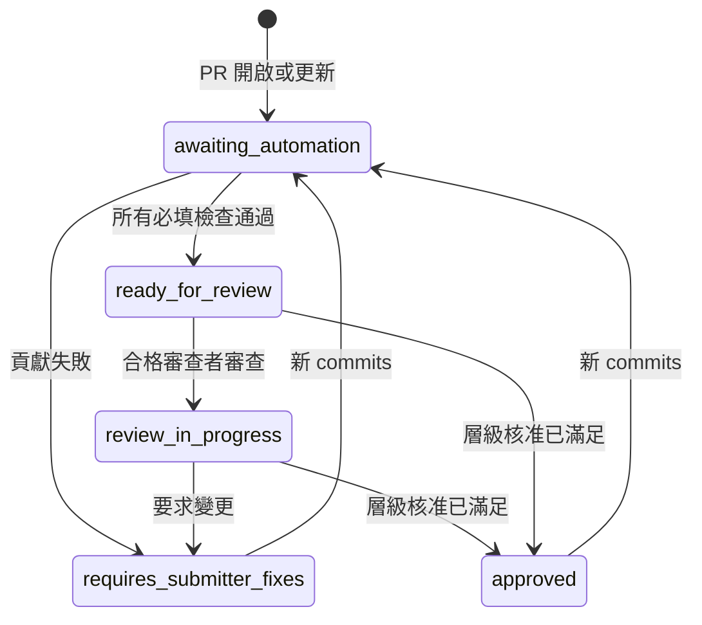

# 提交門禁（Submission gate）

指向 `main` 的 Pull Request 有唯一一個必填狀態：`submission-gate` 檢查。它將倉庫的自動檢查、合併風險層級，以及該層級所需的核准整合為單一結果。它同時會讓 PR 的標籤與狀態留言保持最新，讓貢獻者與審查者看到相同的狀態。

追蹤議題：[github/awesome-copilot#4184](https://github.com/github/awesome-copilot/issues/4184)（第二階段，強制執行）。

| 元件 | 位置 |
|---|---|
| 唯讀評估（reader） | [`.github/workflows/submission-gate.yml`](../../.github/workflows/submission-gate.yml)，工作流 **Submission Gate**，job `evaluate` |
| `submission-gate` 檢查、標籤與狀態留言（writer） | [`.github/workflows/submission-gate-writer.yml`](../../.github/workflows/submission-gate-writer.yml)，工作流 **Submission Gate Writer** |
| PR 指令（reader 與 writer） | [`.github/workflows/pr-commands.yml`](../../.github/workflows/pr-commands.yml)、[`.github/workflows/pr-commands-writer.yml`](../../.github/workflows/pr-commands-writer.yml) |
| 門禁等待的檢查 | [`.github/submission-gate.yml`](../../.github/submission-gate.yml) |
| 風險層級與核准政策 | [`.github/risk-tiers.yml`](../../.github/risk-tiers.yml) |
| 審查者集（第一階段） | `.github/review-routing.yml` |
| 邏輯與測試 | [`eng/submission-gate.mjs`](../../eng/submission-gate.mjs)、[`eng/submission-gate.test.mjs`](../../eng/submission-gate.test.mjs) |

## 門禁如何運作

1. **Submission Gate** 會在每個 PR（`opened`、`synchronize`、`reopened`、`ready_for_review`，以及涵蓋變更基底分支的 `edited`）與每個審查（`submitted`、`edited`、`dismissed`）上執行。它沒有路徑過濾器，所以一律會執行。它的 job 名為 `evaluate`，而且絕不會失敗：它是一個唯讀預覽，其 job summary 會顯示狀態表。
2. 它會 checkout **基底 commit**，而非 PR，並從基底載入其邏輯與政策。唯一的例外是引入門禁的 bootstrap PR：基底還沒有門禁，所以改用 PR 中的門禁，並記錄一則警告。
3. 它會列出 PR 變更的檔案，並挑选 `.github/submission-gate.yml` 中 `branches` 與 `paths` 相符的檢查。這些過濾器對映每個工作流自身的 `pull_request` 觸發器，且每個都包含該工作流檔案本身與其執行的 `eng/` 腳本，所以對某個檢查實作的變更會重新執行該檢查。唯一的例外是 `validate-agentic-workflows-pr.yml`，它會拒絕任何 `.github/**` 的變更，因此無法觸發在自身的檔案上。`eng/submission-gate.test.mjs` 會在兩者出現分歧時失敗。
4. 它會以每 30 秒一次、最多 40 分鐘的間隔輪詢 PR head commit 的 Actions runs。若某項必填檢查回報貢獻失敗，它會提早停止。
5. 在開始時與結束時，**Submission Gate Writer** 會透過 `workflow_run` 以預設分支的程式碼執行。它會從 GitHub API 重建評估：判斷合併風險層級、依據該層級的核准政策評估審查，並計算 PR 狀態。
6. writer 會透過 Checks API 在 PR head commit 上發佈 **`submission-gate` check run**。當檢查待定時，該檢查為 `in_progress`，且**只有在狀態為 `approved` 時才會成功**，也就是每一項必填檢查都通過，且該層級的核准已齊備。否則它會失敗，其 summary 會列出原因。該檢查是在 writer 確認 head、base、風險標籤與審查都未變更後立即發佈，且在其更新標籤與狀態留言之前，所以一次失敗的標籤或留言寫入永遠不會遺留一個過期的綠色檢查。

因為審查會重新執行門禁，所以只要最後一個必填核准抵達，檢查就會轉為綠色。每小時一次的 writer 巡檢（以及帶 `pr_number` 的 `workflow_dispatch`）會刷新那些事件被遺漏的 PR。

`submission-gate` 檢查來自 writer，而非 `pull_request` job，因為 PR 可以編輯其自身的 `pull_request` 工作流。見[安全模型](#security-model)。因此一個 PR 在 writer 進入 `main` 之前不會顯示 `submission-gate`。

writer 會在寫入前不久重新驗證 PR head、基底分支、審查，以及提升風險的標籤（例如 `needs-review:HIGH`）。若在評估期間其中任何一項有變更，它會丟棄該結果，把更新交給較新的執行。reader 也會在等待期間 head 移動時丟棄其結果。

### 檢查

| 檢查 | 工作流 | 套用時機 | 阻擋 |
|---|---|---|---|
| Line endings | `check-line-endings.yml` | 對 `main` 的每個 PR | 是 |
| Spelling | `codespell.yml` | 對 `main` 的每個 PR | 是 |
| 生成的 README 一致性 | `validate-readme.yml` | 資源、`docs/**`、`README.md` | 是 |
| 外掛與擴充驗證 | `validate-plugins.yml` | `plugins/**`、`extensions/**` | 是 |
| Canvas 擴充驗證 | `validate-canvas-extensions.yml` | `extensions/**` | 是 |
| 外掛結構 | `check-plugin-structure.yml` | `plugins/**` | 是 |
| Skill 驗證 | `validate-skills.yml`（新，執行 `npm run skill:validate`） | `skills/**` | 是 |
| Skill lint（vally） | `skill-check.yml` | skills 與 agents | 僅完成 |
| 提交門禁測試 | `validate-submission-gate.yml` | 門禁設定、工作流 | 是 |
| Agentic 工作流驗證 | `validate-agentic-workflows-pr.yml` | `workflows/**` | 是 |
| 風險掃描 | `pr-risk-scan.yml` | 資源目錄 | 僅完成 |
| 貢獻者聲望 | `contributor-check.yml` | 每個 PR | 僅完成 |
| 重複資源掃描 | `pr-duplicate-check.lock.yml` | 每個 PR | 建議 |
| PR 品質訊號 | `pr-quality-signal.lock.yml` | 每個 PR | 建議 |
| Canvas/外掛煙霧測試 | 任何名為 `canvas-smoke-test` 的 job | `extensions/**`、`plugins/**` | 是（若它有回報） |

關於上列各行：

- **僅完成** 表示該工作流將其發現以留言或標籤發布，而不因之失敗。門禁需要該工作流完成；其任何失敗都是基礎設施失敗。貢獻者聲望的風險層級也會送入風險層級。貢獻者聲望會略過 bot 作者，因此它設定 `allow_skip: true`。
- 一個**被其工作流略過的阻擋檢查**未驗證任何東西，所以它是基礎設施失敗，除非該檢查設定 `allow_skip: true` 或 `optional: true`。
- **建議**檢查永不阻擋。若它們失敗，狀態留言會顯示一則警告。
- **Canvas/外掛煙霧測試** 是一個依 check-run 名稱匹配的插槽。#4184 的第三階段會提供它。若沒有此類檢查回報，門禁會略過它。

要新增一個檢查，就新增一個項目到 `.github/submission-gate.yml`。精確複製該工作流的 `branches` 與 `paths`，然後執行 `node --test eng/submission-gate.test.mjs`。

## 基礎設施失敗 vs 貢獻失敗

每一項失敗的檢查都落入兩個類別之一。狀態留言與門禁輸出會顯示是哪一個。

| 類別 | 意義 | 會發生什麼 |
|---|---|---|
| ❌ **貢獻失敗** | 該檢查已執行，並發現 PR 中有問題，例如過期的 README、無效的外掛，或 CRLF 換行。 | 狀態變成 `requires-submitter-fixes`。留言會顯示該檢查的修正提示。 |
| 🔧 **基礎設施失敗** | 自動化本身故障：runner 或設定錯誤、相依安裝、checkout、artifact 傳輸、逾時、取消、等待維護者核准的執行，或永不回報的檢查。 | 狀態維持 `awaiting-automation`。會告知貢獻者這不是他們的責任，並可留言 `/rerun-checks`。 |

一次失敗的執行會依其第一個失敗的步驟來分類：

- 該步驟符合檢查的 `contribution_steps` → 貢獻失敗。
- 該步驟符合全域 `infrastructure_steps`（例如 `Set up job`、`Install dependencies`、`Checkout`） → 基礎設施失敗。
- 一個兩個清單都不符合的失敗步驟 → 貢獻失敗，以確保真正的驗證問題不會被隱藏。
- `timed_out`、`cancelled`、`startup_failure` 與 `action_required` 的執行 → 一律是基礎設施失敗。
- 一項永不回報的必填檢查 → 基礎設施失敗。當其餘一切都已完成且過了 8 分鐘，或當門禁逾時時，門禁宣告它缺失。
- 其工作流執行被略過的一項必填檢查 → 基礎設施失敗，除非它設定 `allow_skip` 或 `optional`。
- GitHub 只回傳了變更檔案清單的一部分（該 API 在 3,000 個檔案處停止） → 基礎設施失敗，且該 PR 為 `merge-risk:high`。請拆分 PR，或請一位維護者手動審查。
- 標記 `failure_kind: infrastructure` 的檢查 → 每一項失敗都是基礎設施失敗。對回報發現而非失敗的工作流使用這個。

### 已知的 AI 輔助檢查間歇性失敗

我們在 `github/awesome-copilot` 上建立門禁時，審查了 agentic 建議工作流近期的執行：

- **PR Quality Signal**（`pr-quality-signal.lock.yml`）：最近 30 次執行中有 4 次失敗、24 次被略過（fork PR；該工作流未選取 fork）。每一次失敗都在 `agent` job，帶有 `awf-reflect: models fetch returned 401`。編譯後的 lock 以 `secrets.COPILOT_GITHUB_TOKEN`（一個 PAT）對 Copilot inference 進行驗證，當該 secret 缺失、過期或未授權時會失敗。修正方式與 `pr-duplicate-check` 相同：為工作流權限加上 `copilot-requests: write`，並用 lock 所使用的版本 gh-aw v0.88.8 重新編譯。該重新編譯是維護者的後續工作。
- **PR Duplicate Check**（`pr-duplicate-check.lock.yml`）：30 次執行中有 27 次成功。它已使用搭配 Actions token 的 `copilot-requests: write`。那 2 次失敗是間歇性的 inference 401。

這兩個工作流只發布建議留言，所以門禁將它們列為 `required: false` 並附 `failure_kind: infrastructure`。它們永不定住門禁：它們執行期間，留言會顯示它們為待定（建議），而門禁不會等它們。它們的失敗也永不阻擋 PR；留言會改而顯示 ⚠️ 警告。

## 合併風險層級

自動化會對每個開啟中的 PR 套用 **剛好一個** `merge-risk:low`、`merge-risk:medium`、`merge-risk:high`。層級依此順序評估；第一個符合者生效。

### High

若符合以下任何一項，PR 就是高風險：

- **任何變更檔案符合高風險路徑：**
  - 審查政策與自動化：`.github/**`（包含工作流、`CODEOWNERS`、`.github/review-routing.yml`、`.github/risk-tiers.yml`、`.github/submission-gate.yml`）、`CODEOWNERS`、`docs/CODEOWNERS`
  - 建構與倉庫腳本：`eng/**`、`scripts/**`、`package.json`、`package-lock.json`
  - MCP 設定：`**/mcp.json`、`**/.mcp.json`
  - 捆綁的可執行檔，包含隨 hooks 一起提供的腳本：`**/*.sh`、`**/*.bash`、`**/*.ps1`、`**/*.psm1`、`**/*.bat`、`**/*.cmd`、`**/*.py`、`skills/**/scripts/**`、`plugins/**/scripts/**`
  - 外部程式碼來源：`plugins/external.json`
  - 生成的 `.github/plugin/marketplace.json` 被排除。
- **新增的 diff 行符合能力觸發器：**
  - 處理執行（`child_process`、`spawn(`、`execSync(`、`eval(`、`new Function`、`node:vm`）在 extensions、plugins、skills 或 website 中
  - 將下載的腳本以 pipe 送入 shell（`curl … | bash`、`irm … | iex`、`Invoke-Expression`）
  - MCP server 或 hook 命令宣告（`mcpServers`、`command`、`bash`、`powershell`）在 plugin、extension、skill 或 hook JSON 中
- **貢獻者風險為高：** PR 帶有 `needs-review:HIGH` 標籤，或 head commit 的貢獻者聲望 artifact 回報 `HIGH`。此訊號可以提升層級，但永不會降低。
- **變更無法被完整掃描**（fail closed）：
  - GitHub 回傳了不完整的變更檔案清單。
  - 能力觸發器範圍內的檔案沒有 diff。GitHub 會省略 binary 檔案與非常大變更的 diff。`high.unscanned_paths` 中的檔案獲豁免：影像、字型、PDF、壓縮檔，以及來源已被掃描的生成文件。
- **另一個來源為 head commit 回報了 `submission-gate` 檢查**。只有 writer 可以發佈它（見[安全模型](#security-model)）。

### Low

若符合以下任何一項，PR 就是低風險：

- 每個變更檔案都是文件、Metadata、生成輸出或影像：`docs/**`、根目錄的 `README.md`、`CONTRIBUTING.md`、`CODE_OF_CONDUCT.md`、`SECURITY.md`、`SUPPORT.md`、`LICENSE`、`.all-contributorsrc`、`.github/plugin/marketplace.json`，或影像檔案。
- 它是對現有資源的小型更新：每個檔案都是*被修改*（無新增、移除或重新命名），每個都是文件路徑或位於 `agents/`、`instructions/`、`skills/`、`plugins/` 或 `extensions/` 之下，且總變更最多 40 行。

### Medium

其餘一切，例如新的 agent、skill、plugin 或 canvas 擴充，或對現有資源的較大重寫。Agentic 工作流（`workflows/**`）與 hooks（`hooks/**`）和任何資源一樣都是內容，除非它們新增一個捆綁腳本或一個 hook 命令（那會使其變成 high），否則都是 medium。

狀態留言包含一個摺疊的「為何此層級」清單，列出所套用的原因。

### 核准政策

| 層級 | 所需核准 |
|---|---|
| `merge-risk:low` | 來自變更資源擁有者的 1 個核准：其領域集，或對不在任何領域內的檔案則為 core 集 |
| `merge-risk:medium` | 來自所觸及領域的領域審查者的 1 個核准 |
| `merge-risk:high` | 2 個核准，包括一位核心維護者 |

核准如何計算：

- 審查者的**最新**具有決定性的審查計算在內：`APPROVED`、`CHANGES_REQUESTED` 或 `DISMISSED`。之後僅含留言的審查不會重設一個核准。
- PR 作者與 bots 永不計算。
- 若審查者擁有 write、maintain 或 admin 權限，或列於 `.github/review-routing.yml` 的任何集中，該核准即合格。若權限查詢失敗，審查者算作沒有權限。`author_association` 永不被用作替代。
- 任何未解決的來自合格審查者的 `CHANGES_REQUESTED` 會阻擋門禁，並把狀態設為 `requires-submitter-fixes`。

領域審查者來自第一階段的路由檔案。`.github/risk-tiers.yml` 的 `domains` 節將路徑對應到集：

| 領域 | 路徑 | 集 |
|---|---|---|
| Canvas | `extensions/**` | `canvas` |
| Plugin | `plugins/**` | `plugin` |
| Content | `agents/**`、`instructions/**`、`skills/**`、`workflows/**`、`hooks/**` | `content` |

core 集是 `core-maintainers`。其成員也滿足領域與資源擁有者要求。不在任何領域內的檔案，例如倉庫自身的 `.github/workflows/**`、`eng/**`、審查政策，以及 `docs/**`，由 core 集擁有。

若路由尚未編制人員，門禁會回退而非阻擋：

- **`.github/review-routing.yml` 缺失，或對應的領域集為空：** 任何擁有 write 存取權的核准者都滿足領域或資源擁有者要求。若檔案存在但無法解析，或 `pools` 不是一個 mapping，門禁會失敗而非回退，以便一次壞掉的編輯無法放寬核准。
- **`core-maintainers` 集為空：** 一個高風險 PR 需要其兩個核准中的一個來自擁有 `admin` 或 `maintain` 權限的使用者。

狀態留言在任一回退生效時會顯示一則註記。

## PR 狀態

每個開啟中的 PR 有 **剛好一個** 狀態標籤。帶 `external-plugin` 標籤的 PR 是例外：外部外掛 intake 工作流擁有那里的共用狀態標籤，所以只有風險標籤與狀態留言被管理。

| 標籤 | 意義 |
|---|---|
| `awaiting-automation` | 必填檢查仍在執行，或其中一項遇到基礎設施失敗 |
| `requires-submitter-fixes` | 一項必填檢查發現貢獻問題，或審查者要求變更 |
| `ready-for-review` | 所有必填檢查都通過；等待審查者 |
| `review-in-progress` | 一位合格審查者已審查，但該層級的核准尚未全部到齊 |
| `approved` | 檢查通過且該層級的核准已滿足；`submission-gate` 為綠色 |

當多個條件同時成立時，此順序中的第一個生效：`requires-submitter-fixes`、`awaiting-automation`、`approved`、`review-in-progress`、`ready-for-review`。

### 狀態留言

writer 每個 PR 保留一則留言，以 `<!-- submission-gate-status -->` 標記並原地更新。它顯示：

- 狀態與風險層級，附帶該層級的原因
- 每一項適用檢查及其結果與 log 連結
- 待辦事項：貢獻修正、基礎設施重試、建議警告
- 核准進度與還需要什麼
- 已指派的審查者（被請求的審查者與團隊）與第一階段 `review-due:YYYY-MM-DD` 標籤中的審查目標日期
- 可用的指令

## 指令

以其中一個指令開頭一個 PR 留言。該指令必須是留言中第一段文字；大小寫無所謂。

| 指令 | 誰可執行 | 它做什麼 |
|---|---|---|
| `/rerun-checks` | PR 作者；擁有 write、maintain 或 admin 的使用者 | 重新執行 head commit 每個失敗、取消或逾時的工作流執行中失敗的 jobs，重新執行門禁，並刷新狀態留言 |
| `/request-review` | PR 作者；擁有 write、maintain 或 admin 的使用者 | 加上 `needs-reviewer`，並在 `main` 上調度第一階段的 `review-routing.yml`，指派一位審查者並設定 `review-due:*` |

其他細節：

- 等待維護者核准首次貢獻者工作流的執行（`action_required`）無法被指令重新執行；回覆會說明這一點。
- 來自 bots 的、以及來自任何其他人的指令，都會被靜默忽略。
- writer 會在開始時以 👀 反應，然後以一則簡短摘要回覆並以 🚀 反應。只有 🚀 反應將留言標記為已處理，所以重新執行工作流不會重複一個已完成的指令，且一個中途失敗的執行可以被重試。

指令使用與門禁相同的 reader/writer 分割，所以它們對來自 forks 的 PR、以及來自沒有 write 存取權貢獻者的 PR 也能運作：

1. **PR Commands**（`pr-commands.yml`）在 `issue_comment` 上以唯讀 token 執行。若留言在一個開啟中的 PR 上且以指令開頭，它會上傳一個 `pr-command-request` artifact，只包含 PR 編號、留言 ID 與執行 ID。
2. **PR Commands Writer**（`pr-commands-writer.yml`）在 `workflow_run` 上以預設分支的程式碼與 write 權限執行。它下載 artifact，驗證其 schema 與執行 ID，然後在動作前重新從 API 讀取留言、PR 與留言者的權限。它永不信任 artifact 中的留言內容或作者。

## 安全模型

- **Reader/writer 分割。** reader 在 `pull_request` 上下文中以唯讀 token 執行。它永不寫入標籤、留言或檢查。**Submission Gate Writer** 在 `workflow_run`、每小時 `schedule` 與 `workflow_dispatch` 上以預設分支的程式碼執行。它會從 GitHub API 重建整個評估，所以它不信任來自 PR 執行的 artifacts。只有當 head SHA、head 倉庫、head 分支與 base 倉庫都相符時，它才把一個執行對應到一個 PR。
- **Writer 發佈必填檢查。** `pull_request` 工作流從 PR merge ref 載入其 YAML，所以一個 PR 可以用一個永遠通過的、名為 `submission-gate` 的 `pull_request` job 取代。因此 writer 自己透過 Checks API 發佈 `submission-gate`，並標記 `external_id: submission-gate-writer`。head commit 上任何其他的 `submission-gate` check run 都視為篡改：該 PR 變成 `merge-risk:high`，門禁以「Gate integrity」貢獻失敗而失敗，且 writer 發佈一個較新的失敗執行，使其結果成為最新。
- **`external_id` 是標記，不是來源證明。** 任何具有 `checks: write` 的工作流都能建立一個具有相同 `external_id` 的執行。Fork PR 拿到唯讀 token，做不了，但在同倉庫分支上 push 觸發的工作流做得到。在每次執行與每小時巡檢中，writer 會覆蓋任何聲稱成功而其自身評估失敗的該檢查副本，並記錄該修正。長久修正是一項維護者後續工作：從一個專屬 GitHub App 發佈該檢查，並在 ruleset 中將必填檢查固定到該 app，且對 `.github/**` 要求 Code Owner 審查。
- **只有受信任的程式碼執行。** 這裡沒有任何工作流以 write token 執行 PR 程式碼。門禁從基底 commit 載入其邏輯，除了上述的 bootstrap 情況，而後者也只有唯讀 token。writer 與指令工作流會 checkout 預設分支，並以 `npm ci --ignore-scripts` 安裝相依。
- **貢獻者聲望 artifact。** 它只被用作僅提升的訊號。它必須符合 schema `contributor-check-result/v1` 與 PR head SHA。若 `pr-check` job 成功但 artifact 缺失或無法讀取，門禁記錄一項基礎設施失敗並阻擋，直到稍後的巡檢讀取它，以便一個遺失的 `HIGH` 訊號無法降低層級。
- **不受信任的文字。** 留言內容永不被插值進腳本：reader 透過環境變數傳遞它們，writer 從 API 重新讀取它們。審查者登入、檢查名稱與詳細資訊在進入 markdown 前會被消毒。
- **篡改其他檢查。** PR 也能編輯門禁等待的驗證工作流。任何此類編輯都會觸及 `.github/**`，使 PR 變成 `merge-risk:high`：2 個核准，包括一位核心維護者。writer 會從預設分支的程式碼計算該層級。
- **檢查來源。** 以 `GITHUB_TOKEN` 建立的 check runs 屬於 GitHub Actions app，與 `pull_request` jobs 相同的 app。在 ruleset 中要求來自 GitHub Actions 的 `submission-gate` 會阻擋其他 apps 與 commit statuses；冒名偵測涵蓋同一 app 中的 jobs。
- **事件。** 以 `GITHUB_TOKEN` 建立的 check runs 不會觸發 `check_run` 工作流。對門禁反應的自動化應監聽 **Submission Gate Writer** 上的 `workflow_run`。
- **速率上限。** 每小時的 writer 巡檢最多刷新最近 30 天內有更新的 60 個開啟中 PR，以便大量待辦保持在 API 速率上限內。

## 維護者後續工作

這些步驟需要倉庫管理員動作，且不會由自動化執行：

- 在 `main` 的 ruleset 中**要求 `submission-gate`**，以 GitHub Actions 作為來源。writer 會在此變更合併後發佈此檢查；在那之前沒有任何 PR 回報它。
- 以執行 **Setup Repository Labels** 工作流**建立新的標籤**：`awaiting-automation`、`review-in-progress`、`merge-risk:*`。
- **編制** `.github/review-routing.yml` 中的集，以便領域與 core 要求不再使用回退。
- **強化檢查來源：** 從一個專屬 GitHub App 發佈 `submission-gate`，並在 ruleset 中從該 app 要求它，以便沒有任何其他工作流能發布一個相符的檢查。
- 在第一階段的 `CODEOWNERS` 落地後，對 `.github/**` **要求 Code Owner 審查**。
- **修正 PR Quality Signal 驗證：** 為 `.github/workflows/pr-quality-signal.md` 加上 `copilot-requests: write`，並用 gh-aw v0.88.8 重新編譯。
