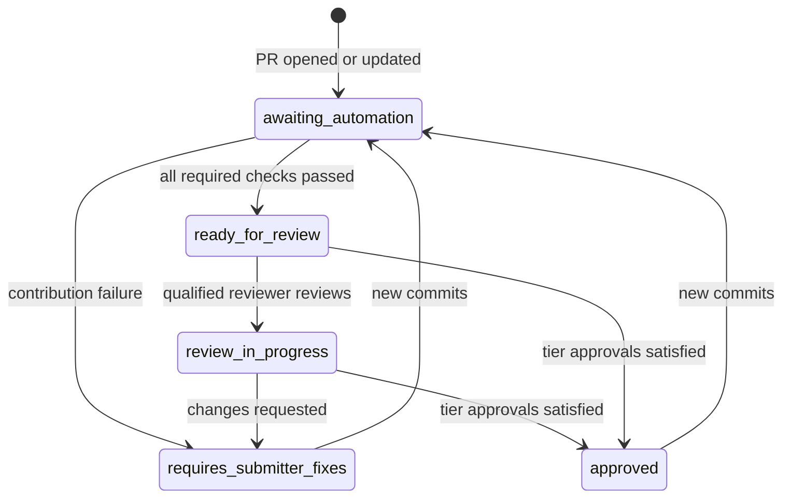

# 提交閘門

`submission-gate` 檢查是合併至 `main` 的拉取請求 (Pull Request) 所需的單一必要狀態。它將存放庫的自動化檢查、合併風險層級以及該層級所需的核准整合成單一結果。它還會讓 PR 標籤與狀態評論保持在最新狀態，讓貢獻者與檢閱者看到相同的狀態。

追蹤 issue：[github/awesome-copilot#4184](https://github.com/github/awesome-copilot/issues/4184)（第 2 階段，強制執行）。

| 組件 | 位置 |
|---|---|
| 唯讀評估（讀取端） | [`.github/workflows/submission-gate.yml`](../../.github/workflows/submission-gate.yml)，工作流程 **Submission Gate**，作業 `evaluate` |
| `submission-gate` 檢查、標籤與狀態評論（寫入端） | [`.github/workflows/submission-gate-writer.yml`](../../.github/workflows/submission-gate-writer.yml)，工作流程 **Submission Gate Writer** |
| PR 指令（讀取端與寫入端） | [`.github/workflows/pr-commands.yml`](../../.github/workflows/pr-commands.yml)、[`.github/workflows/pr-commands-writer.yml`](../../.github/workflows/pr-commands-writer.yml) |
| 閘門等待的檢查 | [`.github/submission-gate.yml`](../../.github/submission-gate.yml) |
| 風險層級與核准政策 | [`.github/risk-tiers.yml`](../../.github/risk-tiers.yml) |
| 檢閱者集區（第 1 階段） | `.github/review-routing.yml` |
| 邏輯與測試 | [`.github/scripts/review/submission-gate.mjs`](../../.github/scripts/review/submission-gate.mjs), [`.github/scripts/review/submission-gate.test.mjs`](../../.github/scripts/review/submission-gate.test.mjs) |

## 閘門運作方式

1. **Submission Gate** 在每個 PR（`opened`、`synchronize`、`reopened`、`ready_for_review` 與涵蓋基準分支變更的 `edited`）以及每次檢閱（`submitted`、`edited`、`dismissed`）時執行。它沒有路徑篩選器，因此一律會執行。其作業名稱為 `evaluate` 且絕不失敗：它是一個唯讀預覽，其作業摘要會顯示狀態表格。
2. 它會簽出**基準 commit**而非 PR，並從該處載入其邏輯與政策。唯一的例外是引入閘門的啟動引導 PR：此時基準尚無閘門，因此會使用來自 PR 的閘門並記錄警告。
3. 它會列出 PR 變更的檔案，並挑選 `.github/submission-gate.yml` 中 `branches` 與 `paths` 相符的檢查。這些篩選器鏡像每個工作流程自己的 `pull_request` 觸發條件，且每個篩選器均包含工作流程檔案本身及其執行的 `.github/scripts/` 指令碼，因此檢查實作的變更會重新執行該檢查。唯一的例外是 `validate-agentic-workflows-pr.yml`，它會拒絕任何 `.github/**` 變更，因此無法由其自己的檔案觸發。若兩者出現偏差，`.github/scripts/review/submission-gate.test.mjs` 會失敗。
4. 它會輪詢 PR head commit 的 Actions 執行，每 30 秒輪詢一次，最多 40 分鐘。若必要檢查回報貢獻失敗，它會提早停止。
5. 當它開始與完成時，**Submission Gate Writer** 會透過 `workflow_run` 以預設分支程式碼執行。它會從 GitHub API 重建評估：將合併風險層級分類、針對該層級的核准政策評估檢閱，並計算 PR 狀態。
6. 寫入端透過 Checks API 在 PR head commit 上發布 **`submission-gate` 檢查執行**。當檢查處於擱置狀態時，該檢查為 `in_progress`，且**僅在狀態為 `approved` 時才會成功**，這表示每個必要檢查皆已通過且符合該層級的核准。否則該檢查失敗，其摘要會列出原因。在寫入端確認 head、基準、風險標籤與檢閱皆未變更之後、更新標籤與狀態評論之前，會立即發布該檢查，因此失敗的標籤或評論寫入絕不會留下過時的綠色通過檢查。

由於檢閱會重新執行閘門，因此一旦最後一項必要核准送達，檢查就會立即變綠。每小時的寫入端批次排程（以及帶有 `pr_number` 的 `workflow_dispatch`）會重新整理遺漏事件的 PR。

`submission-gate` 檢查來自寫入端，而非來自 `pull_request` 作業，因為 PR 可以編輯其本身的 `pull_request` 工作流程。請參閱[安全模型](#security-model)。因此，在寫入端存在於 `main` 之前，PR 不會顯示 `submission-gate`。

寫入端在寫入前會立即重新驗證 PR head、基準分支、檢閱與提高風險的標籤（例如 `needs-review:HIGH`）。若其中任何一項在評估期間發生變更，它會捨棄該結果並將更新留給較新的執行。若在等待期間 head 發生移動，讀取端也會捨棄其結果。

### 檢查項目

| 檢查項目 | 工作流程 | 適用時機 | 具封鎖性 |
|---|---|---|---|
| 行尾換行字元 | `check-line-endings.yml` | 每個對 `main` 提出的 PR | 是 |
| 拼字檢查 | `codespell.yml` | 每個對 `main` 提出的 PR | 是 |
| 產生的 README 一致性 | `validate-readme.yml` | 資源、`docs/**`、`README.md` | 是 |
| 外掛程式與延伸模組驗證 | `validate-plugins.yml` | `plugins/**`、`extensions/**` | 是 |
| Canvas 延伸模組驗證 | `validate-canvas-extensions.yml` | `extensions/**` | 是 |
| 外掛程式結構 | `check-plugin-structure.yml` | `plugins/**` | 是 |
| Skill 驗證 | `validate-skills.yml`（新增，執行 `npm run skill:validate`） | `skills/**` | 是 |
| Skill lint (vally) | `skill-check.yml` | skills 與 agents | 僅限完成狀態 |
| 提交閘門測試 | `validate-submission-gate.yml` | 閘門設定、工作流程 | 是 |
| 代理人工作流程驗證 | `validate-agentic-workflows-pr.yml` | `workflows/**` | 是 |
| 風險掃描 | `pr-risk-scan.yml` | 資源目錄 | 僅限完成狀態 |
| 貢獻者信譽 | `contributor-check.yml` | 每個 PR | 僅限完成狀態 |
| 重複資源掃描 | `pr-duplicate-check.lock.yml` | 每個 PR | 建議性質 |
| PR 品質訊號 | `pr-quality-signal.lock.yml` | 每個 PR | 建議性質 |
| Canvas／外掛程式冒煙測試 | 任何名為 `canvas-smoke-test` 的作業 | `extensions/**`、`plugins/**` | 是，若有回報 |

關於上方資料列的附註：

- **僅限完成狀態**表示工作流程會將其發現發布為評論或標籤，而不會因發現問題而失敗。閘門需要工作流程執行完成；其任何失敗皆屬於基礎結構失敗。貢獻者信譽風險層級也會提供給風險層級參考。貢獻者信譽會略過機器人作者，因此它設定了 `allow_skip: true`。
- **其工作流程略過的封鎖性檢查**未驗證任何內容，因此屬於基礎結構失敗，除非該檢查設定了 `allow_skip: true` 或 `optional: true`。
- **建議性質**的檢查絕不封鎖。若它們失敗，狀態評論會顯示警告。
- **Canvas／外掛程式冒煙測試**是一個依檢查執行名稱比對的可外掛插槽。#4184 的第 3 階段提供了此功能。若沒有此類檢查回報，閘門會略過它。

若要新增檢查，請在 `.github/submission-gate.yml` 中新增項目。精確複製工作流程的 `branches` 與 `paths`，然後執行 `node --test .github/scripts/review/submission-gate.test.mjs`。

## 基礎結構失敗 vs 貢獻失敗

每個失敗的檢查皆歸入兩個類別之一。狀態評論與閘門輸出會顯示屬於哪一類。

| 類別 | 意義 | 處理方式 |
|---|---|---|
| ❌ **貢獻失敗** | 檢查已執行並在 PR 中發現問題，例如過期的 README、無效的外掛程式或 CRLF 行尾換行字元。 | 狀態變為 `requires-submitter-fixes`。評論會顯示該檢查的修正提示。 |
| 🔧 **基礎結構失敗** | 自動化機制本身損毀：執行器或設定錯誤、相依套件安裝、簽出、成品傳輸、逾時、取消、等待維護人員核准的執行，或是從未回報的檢查。 | 狀態保持為 `awaiting-automation`。系統會告知貢獻者這並非其問題，貢獻者可以留言 `/rerun-checks`。 |

失敗的執行依其第一個失敗的步驟進行分類：

- 步驟與檢查的 `contribution_steps` 相符 → 貢獻失敗。
- 步驟與全域 `infrastructure_steps` 相符（例如 `Set up job`、`Install dependencies`、`Checkout`）→ 基礎結構失敗。
- 失敗的步驟與兩者清單皆不相符 → 貢獻失敗，因此真正的驗證問題絕不會被隱藏。
- `timed_out`、`cancelled`、`startup_failure` 與 `action_required` 執行 → 一律為基礎結構失敗。
- 從未回報的必要檢查 → 基礎結構失敗。一旦其他所有項目皆已完成且經過 8 分鐘，或者當閘門逾時，閘門即宣告其遺失。
- 其工作流程執行被略過的必要檢查 → 基礎結構失敗，除非它設定了 `allow_skip` 或 `optional`。
- GitHub 僅傳回部分已變更檔案清單（API 在 3,000 個檔案處停止）→ 基礎結構失敗，且 PR 評定為 `merge-risk:high`。請拆分 PR 或由維護人員手動檢閱。
- 標記為 `failure_kind: infrastructure` 的檢查 → 每次失敗皆為基礎結構失敗。這適用於回報調查結果而非以此判定失敗的工作流程。

### AI 輔助檢查中已知的間歇性失敗

我們在建置閘門時檢視了 `github/awesome-copilot` 上代理人建議工作流程最近的執行情況：

- **PR Quality Signal** (`pr-quality-signal.lock.yml`)：最近 30 次執行中有 4 次失敗，24 次被略過（fork PR；工作流程未選擇加入 fork）。每次失敗都發生在 `agent` 作業中，伴隨 `awf-reflect: models fetch returned 401`。已編譯的鎖定檔使用 `secrets.COPILOT_GITHUB_TOKEN`（PAT）驗證 Copilot 推論，當該 secret 遺失、過期或未取得授權時就會失敗。修正方式與 `pr-duplicate-check` 相同：將 `copilot-requests: write` 新增至工作流程權限，並使用鎖定檔所採用的 gh-aw v0.88.8 版本重新編譯。該重新編譯屬於維護人員後續追蹤工作。
- **PR Duplicate Check** (`pr-duplicate-check.lock.yml`)：30 次執行中有 27 次成功。它已經將 `copilot-requests: write` 搭配 Actions 權杖使用。2 次失敗屬於間歇性推論 401。

兩個工作流程僅發布建議性評論，因此閘門將它們列為 `required: false` 且帶有 `failure_kind: infrastructure`。它們絕不會阻擋閘門：當它們執行時，評論會將它們顯示為擱置中（建議性質），且閘門不會等待它們。它們的失敗也絕不會封鎖 PR；評論會改為顯示 ⚠️ 警告。

## 合併風險層級

自動化機制會為每個開啟的 PR 套用 `merge-risk:low`、`merge-risk:medium`、`merge-risk:high` **剛好其中之一**。層級依此順序評估；以第一個相符者為準。

### 高 (High)

若符合下列任一條件，PR 即為高風險：

- **任何變更的檔案符合高風險路徑：**
  - 檢閱政策與自動化機制：`.github/**`（包含工作流程、`CODEOWNERS`、`.github/review-routing.yml`、`.github/risk-tiers.yml`、`.github/submission-gate.yml`）、`CODEOWNERS`、`docs/CODEOWNERS`
  - 建置與存放庫指令碼：`.github/scripts/**`、`scripts/**`、`package.json`、`package-lock.json`
  - MCP 設定：`**/mcp.json`、`**/.mcp.json`
  - 隨附的可執行檔，包含隨 hook 一起發布的指令碼：`**/*.sh`、`**/*.bash`、`**/*.ps1`、`**/*.psm1`、`**/*.bat`、`**/*.cmd`、`**/*.py`、`skills/**/scripts/**`、`plugins/**/scripts/**`
  - 外部程式碼來源：`plugins/external.json`
  - 自動產生的 `.github/plugin/marketplace.json` 已排除在外。
- **新增的 diff 行符合功能觸發條件：**
  - 在延伸模組、外掛程式、skill 或網站中執行處理程序（`child_process`、`spawn(`、`execSync(`、`eval(`、`new Function`、`node:vm`）
  - 將下載的指令碼透過管線傳送至 shell（`curl … | bash`、`irm … | iex`、`Invoke-Expression`）
  - 在外掛程式、延伸模組、skill 或 hook JSON 中的 MCP 伺服器或 hook 指令宣告（`mcpServers`、`command`、`bash`、`powershell`）
- **貢獻者風險偏高：** PR 具有 `needs-review:HIGH` 標籤，或 head commit 的貢獻者信譽成品回報 `HIGH`。此訊號可以提升層級，但絕不能降低層級。
- **變更無法完全掃描**（關閉失敗原則）：
  - GitHub 傳回不完整的已變更檔案清單。
  - 位於功能觸發範圍內的檔案沒有 diff。GitHub 會省略二進位檔案與極大變更的 diff。`high.unscanned_paths` 中的檔案可予免除：影像、字型、PDF、封存檔以及來源已受掃描的已產生文件。
- **另一個來源針對 head commit 回報了 `submission-gate` 檢查**。僅允許寫入端發布此檢查（請參閱[安全模型](#security-model)）。

### 低 (Low)

若符合下列任一條件，PR 即為低風險：

- 每個變更的檔案均為說明文件、metadata、產生的輸出或影像：`docs/**`、根目錄 `README.md`、`CONTRIBUTING.md`、`CODE_OF_CONDUCT.md`、`SECURITY.md`、`SUPPORT.md`、`LICENSE`、`.all-contributorsrc`、`.github/plugin/marketplace.json` 或影像檔案。
- 它屬於對現有資源的小型更新：每個檔案皆為*修改*（未新增、移除或重新命名任何檔案），每個路徑皆為文件路徑或位於 `agents/`、`instructions/`、`skills/`、`plugins/` 或 `extensions/` 下，且總變更行數最多 40 行。

### 中 (Medium)

其他所有內容，例如新的 agent、skill、外掛程式或 canvas 延伸模組，或是對現有資源較大幅度的重寫。代理人工作流程 (`workflows/**`) 與 hook (`hooks/**`) 如同其他任何資源一樣屬於內容，除非它們新增隨附指令碼或 hook 指令，否則均屬於中度風險（若新增則升為高風險）。

狀態評論包含一個可摺疊的「為何屬於此層級」清單，列出適用的原因。

### 核准政策

| 層級 | 必要核准 |
|---|---|
| `merge-risk:low` | 來自變更資源擁有者的 1 次核准：其領域集區，若為所有領域之外的檔案則為核心集區 |
| `merge-risk:medium` | 來自所涉及領域的領域檢閱者的 1 次核准 |
| `merge-risk:high` | 來自核心維護人員的 1 次核准 |

核准的計算方式：

- 採計檢閱者**最新**的決定性檢閱：`APPROVED`、`CHANGES_REQUESTED` 或 `DISMISSED`。後續僅發表的評論檢閱不會重設核准狀態。
- PR 作者與機器人絕不計入。
- 若檢閱者具備 write、maintain 或 admin 權限，或列在 `.github/review-routing.yml` 的任何集區中，則其核准符合資格。若權限查詢失敗，該檢閱者視同無權限。`author_association` 絕不用作替代依據。
- 來自符合資格檢閱者的任何未解決 `CHANGES_REQUESTED` 皆會阻擋閘門，並將狀態設定為 `requires-submitter-fixes`。

領域檢閱者來自第 1 階段的路由檔案。`.github/risk-tiers.yml` 的 `domains` 區段將路徑對應至集區：

| 領域 | 路徑 | 集區 |
|---|---|---|
| Canvas | `extensions/**` | `canvas` |
| 外掛程式 | `plugins/**` | `plugin` |
| 內容 | `agents/**`、`instructions/**`、`skills/**`、`workflows/**`、`hooks/**` | `content` |

核心集區為 `core-maintainers`。其成員亦可滿足領域與資源擁有者需求。所有領域之外的檔案（例如存放庫本身的 `.github/workflows/**`、`.github/scripts/**`、檢閱政策與 `docs/**`）歸核心集區所屬。

若路由機制尚未配置人員，閘門會採取遞補措施而非直接封鎖：

- **`.github/review-routing.yml` 遺失，或相符的領域集區為空：** 任何具備寫入權限的核准者皆可滿足領域或資源擁有者需求。若檔案存在但無法剖析，或 `pools` 不是對應表，閘門會判定失敗而非遞補，以防損毀的編輯放寬核准標準。
- **`core-maintainers` 集區為空：** 高風險 PR 需要來自具備 `admin` 或 `maintain` 權限使用者的核准。

當阻擋 PR 的唯一原因僅是缺少核准時，`submission-gate` 檢查會回報 `action_required`（"Action required"）而非 `failure`，因此其語意為「等待檢閱者」而非工作流程損毀。檢查摘要會明確列出缺少的部分。如同任何未通過的必要檢查一樣，它仍會封鎖合併。失敗的檢查與請求變更仍會回報 `failure`。

每當有遞補措施生效時，狀態評論皆會顯示提示附註。

## PR 狀態

每個開啟的 PR 皆有**剛好一個**狀態標籤。標有 `external-plugin` 的 PR 屬於例外：外部外掛程式進件工作流程擁有該處的共用狀態標籤，因此該處僅管理風險標籤與狀態評論。

| 標籤 | 意義 |
|---|---|
| `awaiting-automation` | 必要檢查仍在執行中，或其中一項發生基礎結構失敗 |
| `requires-submitter-fixes` | 必要檢查發現貢獻問題，或檢閱者已請求變更 |
| `ready-for-review` | 所有必要檢查皆已通過；等待檢閱者 |
| `review-in-progress` | 符合資格的檢閱者已進行檢閱，但該層級的核准尚未全數到齊 |
| `approved` | 檢查已通過且滿足該層級的核准；`submission-gate` 為綠色通過 |

當多個條件同時成立時，依此順序以第一個為準：`requires-submitter-fixes`、`awaiting-automation`、`approved`、`review-in-progress`、`ready-for-review`。

### 狀態評論

寫入端為每個 PR 保留一則評論，以 `<!-- submission-gate-status -->` 標記並就地更新。它會顯示：

- 狀態與風險層級，以及該層級的判定原因
- 每個適用的檢查及其結果與記錄連結
- 行動項目：貢獻修正、基礎結構重試、建議性警告
- 核准進度以及仍缺少的部分
- 指派的檢閱者（受請求的檢閱者與團隊）以及來自第 1 階段 `review-due:YYYY-MM-DD` 標籤的檢閱目標日期
- 可用的指令

## 指令

以這些指令之一作為 PR 評論的開頭。該指令必須是評論中的最前端文字；大小寫無差別。

| 指令 | 執行權限對象 | 功能說明 |
|---|---|---|
| `/rerun-checks` | PR 作者；具備 write、maintain 或 admin 權限的使用者 | 針對 head commit 重新執行每個失敗、取消或逾時之工作流程執行的失敗作業，重新執行閘門，並重新整理狀態評論 |
| `/request-review` | PR 作者；具備 write、maintain 或 admin 權限的使用者 | 新增 `needs-reviewer` 並在 `main` 上分派第 1 階段的 `review-routing.yml`，後者會指派檢閱者並設定 `review-due:*` |

其他詳細資訊：

- 等待維護人員為初次貢獻者核准工作流程的執行 (`action_required`) 無法透過指令重新執行；回覆中會對此進行說明。
- 來自機器人與其他任何人的指令皆會被無訊息忽略。
- 寫入端在啟動時會以 👀 做出回應，接著回覆簡短摘要並以 🚀 做出回應。只有 🚀 回應才會將評論標記為已處理，因此重新執行工作流程不會重複執行已完成的指令，而中途失敗的執行則可以重試。

指令採用與閘門相同的讀取者／寫入者分離架構，因此可適用於來自 fork 以及無寫入權限貢獻者的 PR：

1. **PR Commands** (`pr-commands.yml`) 使用唯讀權杖在 `issue_comment` 上執行。若評論位於開啟的 PR 上且以指令開頭，它會上傳僅包含 PR 編號、評論 ID 與執行 ID 的 `pr-command-request` 成品。
2. **PR Commands Writer** (`pr-commands-writer.yml`) 透過 `workflow_run` 以預設分支程式碼與寫入權限執行。它會下載成品、驗證其結構描述與執行 ID，接著在採取動作前從 API 重新讀取評論、PR 以及留言者的權限。它絕不信任來自成品的評論主體或作者。

## 安全模型

- **讀取者／寫入者分離。** 讀取端在 `pull_request` 環境中以唯讀權杖執行。它絕不寫入標籤、評論或檢查。**Submission Gate Writer** 透過 `workflow_run`、每小時 `schedule` 以及 `workflow_dispatch` 以預設分支程式碼執行。它從 GitHub API 重建整個評估，因此不信任來自 PR 執行的成品。唯有在 head SHA、head 存放庫、head 分支與基準存放庫皆相符時，它才會將執行對應至 PR。
- **寫入端發布必要檢查。** `pull_request` 工作流程從 PR 合併 ref 載入其 YAML，因此 PR 可能會將名為 `submission-gate` 的 `pull_request` 作業替換為一律通過的作業。因此，寫入端自行透過 Checks API 發布 `submission-gate`，並標註 `external_id: submission-gate-writer`。head commit 上的任何其他 `submission-gate` 檢查執行皆被視為竄改：PR 變為 `merge-risk:high`，閘門因「閘門完整性」(Gate integrity) 貢獻失敗而失敗，且寫入端發布較新的失敗執行，讓其結果成為最新版本。
- **`external_id` 是標記，而非來源證明。** 任何具備 `checks: write` 的工作流程都可以建立具有相同 `external_id` 的執行。Fork PR 取得唯讀權杖因而無法做到，但同存放庫分支上由 push 觸發的工作流程則可以。在每次執行與每小時的批次排程中，寫入端會覆寫任何在其自身評估失敗時聲稱成功的檢查複本，並記錄更正。長期的修復方案為維護人員的後續工作：從專屬的 GitHub App 發布檢查，並將規則集的必要檢查釘選至該應用程式，同時對 `.github/**` 要求 Code Owner 檢閱。
- **僅執行受信任的程式碼。** 此處的工作流程絕不會使用寫入權杖執行 PR 程式碼。閘門從基準 commit 載入其邏輯（除了上述啟動引導情況外，該情況仍僅具備唯讀權杖）。寫入端與指令工作流程簽出預設分支，並使用 `npm ci --ignore-scripts` 安裝相依套件。
- **貢獻者信譽成品。** 僅用作只升不降的訊號。它必須符合結構描述 `contributor-check-result/v1` 與 PR head SHA。若 `pr-check` 作業成功但成品遺失或無法讀取，閘門會記錄基礎結構失敗並封鎖，直到後續的批次排程讀取它為止，因此遺失的 `HIGH` 訊號無法降低層級。
- **不受信任的文字。** 評論主體絕不插值至指令碼中：讀取端透過環境變數傳遞它們，寫入端則從 API 重新讀取它們。檢閱者帳號、檢查名稱與詳細資訊在納入 markdown 之前皆經過無害化清理。
- **竄改其他檢查。** PR 也可以編輯閘門所等待的驗證工作流程。任何此類編輯皆會涉及 `.github/**`，這會使 PR 評定為 `merge-risk:high`：需要 1 位核心維護人員的核准。寫入端從預設分支程式碼計算該層級。
- **檢查來源。** 使用 `GITHUB_TOKEN` 建立的檢查執行屬於 GitHub Actions 應用程式，與 `pull_request` 作業屬於同一個應用程式。在規則集中要求來自 GitHub Actions 的 `submission-gate` 會封鎖其他應用程式與 commit 狀態；冒充偵測則涵蓋同一個應用程式中的作業。
- **事件。** 使用 `GITHUB_TOKEN` 建立的檢查執行不會觸發 `check_run` 工作流程。對閘門做出反應的自動化機制應接聽 **Submission Gate Writer** 上的 `workflow_run`。
- **速率限制。** 每小時的寫入端批次排程最多重新整理過去 30 天內更新的 60 個開啟中 PR，因此龐大的待處理項目可維持在 API 速率限制內。

## 維護人員後續追蹤

這些步驟需要存放庫管理員動作，無法由自動化機制完成：

- 在 `main` 規則集中**要求 `submission-gate`**，並以 GitHub Actions 為來源。寫入端在此變更合併後發布此檢查；在此之前沒有任何 PR 會回報它。
- 透過執行 **Setup Repository Labels** 工作流程**建立新標籤**：`awaiting-automation`、`review-in-progress`、`merge-risk:*`。
- 在 `.github/review-routing.yml` 中**配置集區人員**，讓領域與核心需求停止使用遞補措施。
- **強化檢查來源：** 從專屬的 GitHub App 發布 `submission-gate`，並在規則集中要求來自該應用程式的檢查，以確保其他工作流程無法發布相符的檢查。
- 一旦第 1 階段的 `CODEOWNERS` 上線，對 `.github/**` **要求 Code Owner 檢閱**。
- **修復 PR Quality Signal 驗證：** 將 `copilot-requests: write` 新增至 `.github/workflows/pr-quality-signal.md`，並使用 gh-aw v0.88.8 重新編譯。
