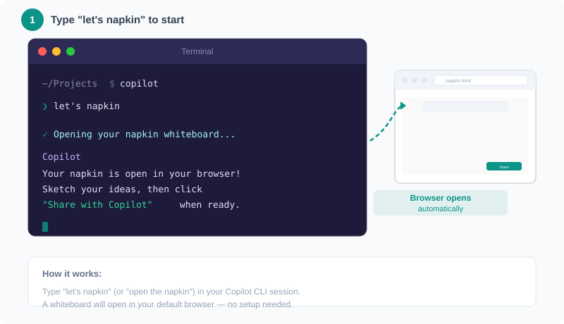
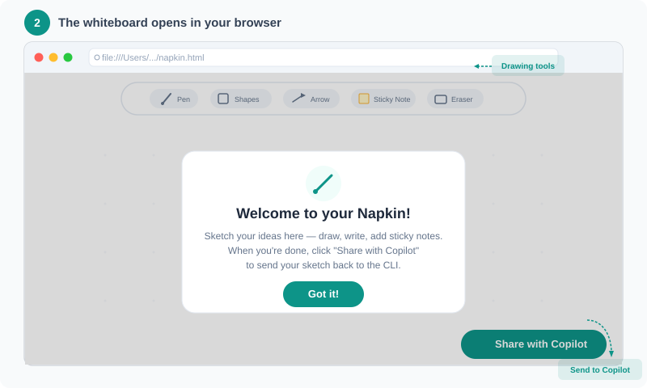
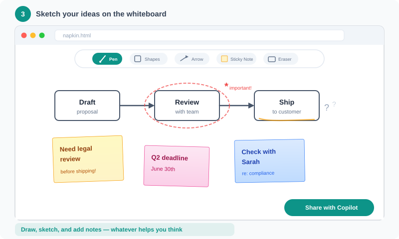
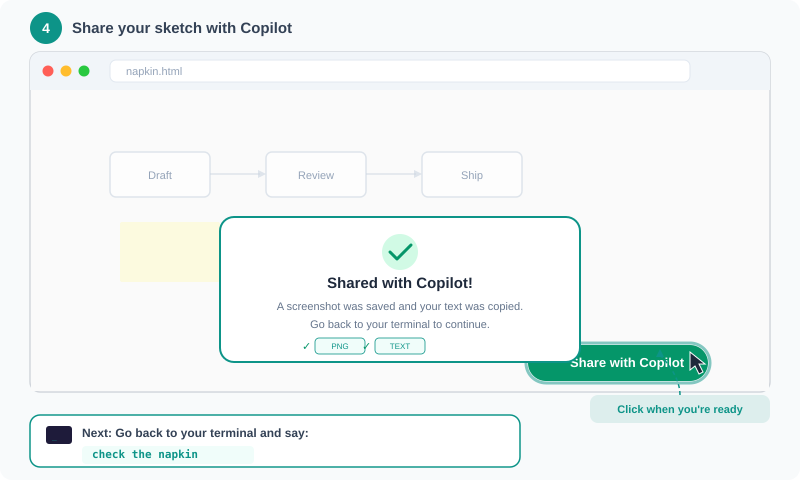
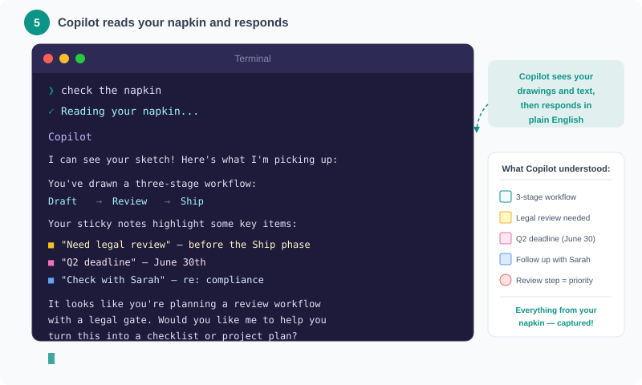

# Napkin — 適用於 Copilot CLI 的視覺化白板

在您的瀏覽器中開啟並連接至 Copilot CLI 的白板。繪圖、草繪、新增便利貼 — 然後將所有內容分享回 Copilot。Copilot 會檢視您的繪圖並以分析、建議和想法進行回應。

專為非軟體開發人員打造：律師、PM、業務利害關係人、設計師、作家 — 任何以視覺方式思考更好的人。

## 安裝

直接從 Copilot CLI 安裝外掛程式：

```bash
copilot plugin install napkin@awesome-copilot
```

就這樣。不需要其他軟體、帳戶或設定。

### 驗證已安裝

在 Copilot CLI 中執行此指令以確認外掛程式可用：

```
/skills
```

您應該會在可用技能清單中看到 **napkin**。

## 如何使用

### 步驟 1：說 "let's napkin"

開啟 Copilot CLI 並輸入 `let's napkin`（或 "open a napkin" 或 "start a whiteboard"）。Copilot 會建立一個白板並在您的瀏覽器中開啟它。



### 步驟 2：您的白板開啟

一個帶有簡單繪圖工具的乾淨白板會出現在您的瀏覽器中。如果是您第一次使用，快速歡迎訊息會說明所有運作方式。



### 步驟 3：繪圖與腦力激盪

使用工具草繪想法、新增便利貼、在概念之間繪製箭頭 — 任何有助於您思考的方式。這是您的空間。



### 步驟 4：與 Copilot 分享

當您準備好取得 Copilot 的意見時，按一下綠色的 **Share with Copilot** 按鈕。它會儲存螢幕擷取畫面並複製您的筆記。



### 步驟 5：Copilot 回應

返回您的終端機並說 `check the napkin`。Copilot 會檢視您的白板 — 包括您的繪圖 — 並進行回應。



## 內含項目

### 技能 (Skill)

| 技能 | 說明 |
|-------|-------------|
| `napkin` | 視覺化白板協作 — 建立白板、解讀您的繪圖與筆記，並以對話方式回應 |

### 隨附資產

| 資產 | 說明 |
|-------|-------------|
| `assets/napkin.html` | 白板應用程式 — 在任何瀏覽器中開啟的單一 HTML 檔案，無需安裝 |

## 白板功能

| 功能 | 用途 |
|---------|-------------|
| **手繪** | 使用畫筆工具繪圖，就像在紙上一樣 |
| **圖形** | 矩形、圓形、線條和箭頭 — 不規則的形狀會對齊為俐落版本 |
| **便利貼** | 可拖曳、可調整大小、顏色編碼的筆記（黃色、粉紅色、藍色、綠色） |
| **文字標籤** | 按一下任何位置即可直接在畫布上輸入文字 |
| **平移與縮放** | 按住空白鍵並拖曳以四處移動；滾動以縮放 |
| **復原/重做** | 弄錯了嗎？Ctrl+Z 復原，Ctrl+Shift+Z 重做 |
| **自動儲存** | 您的工作會自動儲存 — 關閉分頁，稍後返回，它仍然在那裡 |
| **與 Copilot 分享** | 一個按鈕即可匯出螢幕擷取畫面並複製您的文字內容 |

## Copilot 如何理解您的繪圖

當您按一下「Share with Copilot」時，會發生兩件事：

1. **儲存螢幕擷取畫面**（在您的「下載」或「桌面」資料夾中的 `napkin-snapshot.png`）。Copilot 會讀取此影像並能看到所有內容 — 草圖、箭頭、分組、註解、便利貼、空間配置。

2. **您的文字已複製到剪貼簿。** 這會為 Copilot 提供來自您便利貼與標籤的精確文字，因此不會從影像中誤讀任何內容。

Copilot 會同時使用兩者來理解您的想法並作為協作者進行回應 — 不是分析資料的電腦，而是看著您白板草圖的同事。

## 您可以畫什麼？

任何內容。但以下是 Copilot 特別擅長解讀的一些事物：

| 您繪製的內容 | Copilot 理解的內容 |
|---------------|------------------------|
| 由箭頭連接的方塊 | 流程或工作流程 |
| 圈在一起的項目 | 一組相關的想法 |
| 不同顏色的便利貼 | 類別或優先級 |
| 劃掉的文字 | 被拒絕或降低優先級的事物 |
| 星號或驚嘆號 | 高優先級項目 |
| 相反兩側的項目 | 比較或對比 |
| 概略的組織架構圖 | 報告結構或團隊配置 |

## 鍵盤快捷鍵

您不需要這些 — 所有操作都可以透過滑鼠點擊完成。但如果您想工作得更快：

| 按鍵 | 工具 |
|-----|------|
| V | 選取 / 移動 |
| P | 畫筆 (繪圖) |
| R | 矩形 |
| C | 圓形 |
| A | 箭頭 |
| L | 線條 |
| T | 文字 |
| N | 新便利貼 |
| E | 橡皮擦 |
| Delete | 刪除所選項目 (尚未支援) |
| Ctrl+Z | 復原 |
| Ctrl+Shift+Z | 重做 |
| Space + 拖曳 | 平移畫布 |
| ? | 顯示說明 |

## 常見問題 (FAQ)

**除了外掛程式之外，我還需要安裝其他東西嗎？**
不需要。白板是在您的瀏覽器中開啟的單一 HTML 檔案。無需應用程式、無需帳戶、無需設定。

**它可以離線運作嗎？**
可以。所有內容都在您的瀏覽器本機執行。白板本身不需要網際網路連線。

**支援哪些瀏覽器？**
任何現代瀏覽器 — Chrome、Safari、Edge、Firefox。Chrome 對於「複製到剪貼簿」功能效果最好。

**我可以儲存我的工作嗎？**
可以，自動儲存。白板每隔幾秒就會儲存到您瀏覽器的本機儲存空間中。關閉分頁，稍後返回，您的工作仍然存在。

**Copilot 真的能理解我的繪圖嗎？**
可以。為 Copilot CLI 提供動力的 AI 模型 (Claude、GPT) 可以解讀影像。它們可以看到您的草圖、讀取您的手寫風格文字、理解空間關係，並解讀常見的視覺模式，例如流程圖、分組和註解。

**如果我不擅長畫畫怎麼辦？**
沒關係。白板會將不規則的形狀對齊為俐落版本，並且 Copilot 經過訓練可以解讀粗略的草圖。簡筆畫與凌亂的箭頭也能正常運作。

**如何重新開始？**
在 CLI 中再次說 "let's napkin"。Copilot 會詢問您要保留現有白板還是重新開始。

**支援哪些平台？**
macOS、Linux 與 Windows。白板可在任何瀏覽器中執行。剪貼簿整合使用平台原生工具（macOS 上的 `pbpaste`、Linux 上的 `xclip`、Windows 上的 PowerShell）。

## 來源

此外掛程式是 [Awesome Copilot](https://github.com/github/awesome-copilot) 的一部分，這是一個由社群驅動的 GitHub Copilot 擴充功能集合。

## 授權條款

MIT
