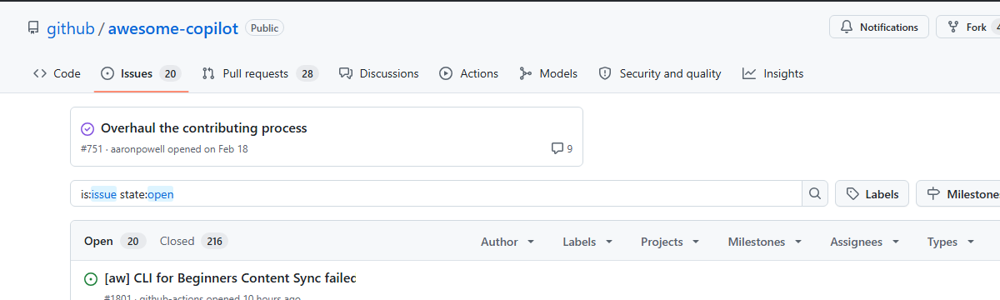
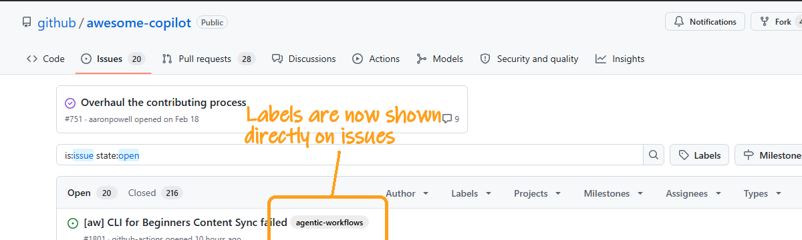
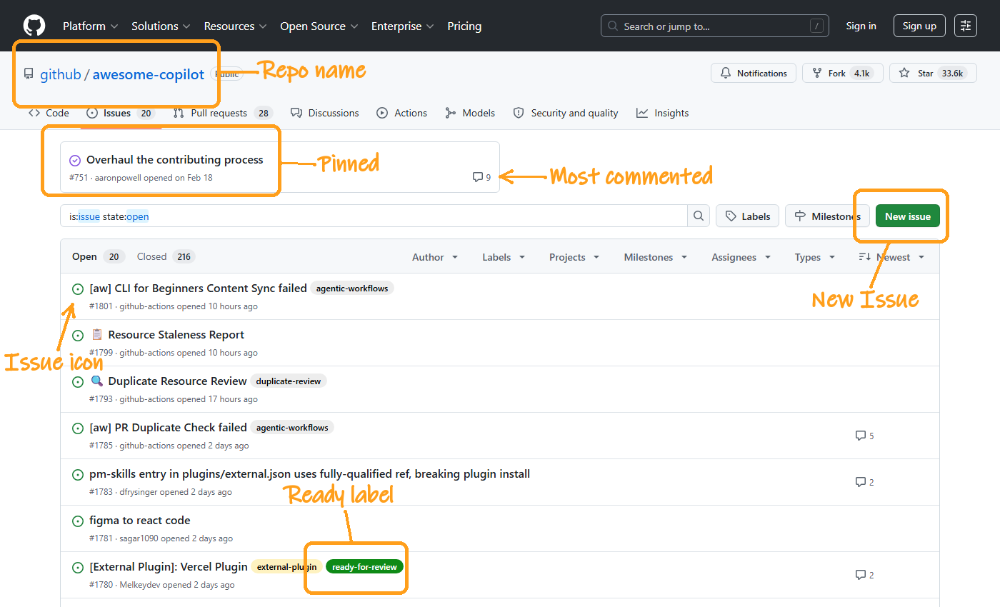
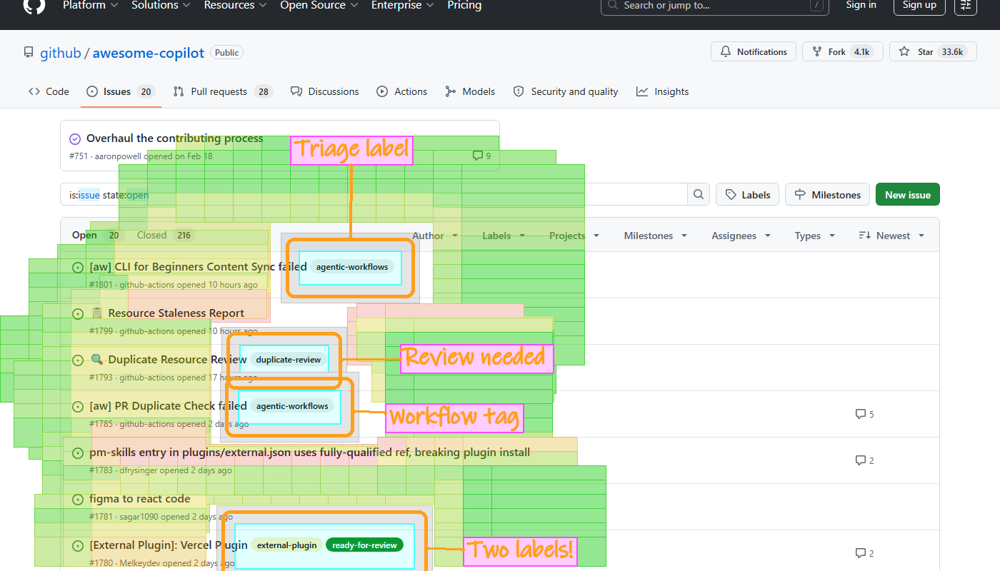

# Visual PR 外掛程式

當您變更外觀時 — 版面配置、圖表、表單 — PR 說明應該展示該變更。而不是僅用文字描述。而是直接展示。前後對照螢幕截圖能確切告訴您的審查者發生了什麼改變，且他們無需切換分支即可看到。

此外掛程式引導 Copilot 擷取您的 Web 應用程式（或任何 UI）的螢幕截圖、加上標註圖標，並嵌入到 PR 說明中。一旦您習慣在每次視覺變更時提供最新的螢幕截圖，回退到純文字 PR 就如同閉著眼睛審查程式碼一樣。

## 示範 🎬

現在是 2009 年。您剛剛新增了在 issue 上顯示標籤的功能。您最好附上螢幕截圖，因為這是一項重大改動。

以下是使用此外掛程式後的 PR 說明外觀：

> **之前 (Before)** — 沒有標籤的 issue 清單：
>
> 
>
> **之後 (After)** — 標籤直接顯示在每個 issue 列上：
>
> 

---

## 不僅僅適用於 PR

相同的標註引擎適用於任何螢幕截圖。以下是一個單一提示：

> *"前往 github/awesome-copilot 的 GitHub issue 頁面。截取 issue 清單並加上標註：任何 issue 圖示、ready-for-review 標籤、存放庫名稱、釘選的 issue、我的顯示圖片、留言最多的 issue、New Issue 按鈕。"*

Agent 擷取了頁面，識別出 7 個請求元素中的 6 個，並為它們全部加上標註。它正確報告第 7 個（使用者顯示圖片）不可見，因為該頁面是在未驗證狀態下擷取的 — 沒有虛構幻覺的標註。

### 除錯模式

每次標註執行都可以產生除錯熱圖，顯示演算法如何選擇標籤位置 — 對比度評分、排除區域以及候選排名：

---

## 包含的技能

| 技能 | 功能介紹 |
|-------|-------------|
| [ui-screenshots](../../skills/ui-screenshots/SKILL.md) | 使用 Playwright + PIL 裁切工作流程擷取 Web UI 螢幕截圖 |
| [image-annotations](../../skills/image-annotations/SKILL.md) | 使用標註矩形、箭頭、標籤和以色彩編碼的高亮來標註任何圖片 |
| [pr-screenshots](../../skills/pr-screenshots/SKILL.md) | 在 PR 說明中嵌入前後對照圖片 (GitHub + Azure DevOps) |
| [screen-recording](../../skills/screen-recording/SKILL.md) | 建立具備可變時間長度的帶標註動畫 GIF 示範 |

## 使用案例

- **視覺化 PR** — 向審查者展示變更內容，無需切換分支
- **版本資訊** — 嵌入新功能的 GIF 示範
- **錯誤回報** — 提供證明已修正的前後對照螢幕截圖
- **文件** — 帶有凸顯關鍵區域標註圖標的螢幕截圖

## 需求

此外掛程式需要能夠檢視圖片的模型 — 該工作流程依賴於檢視螢幕截圖來尋找裁切座標並驗證標註。此 README 中的示範圖片是使用 **Claude Opus 4.6** 所產生的。
