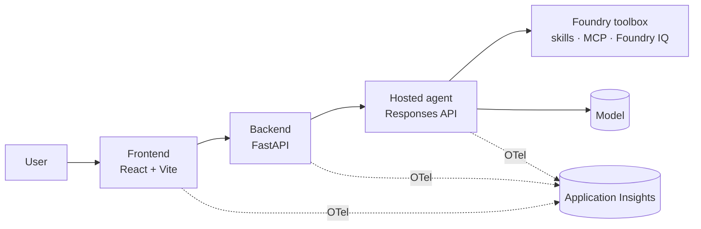

# {Solution} — 規格書

> 上次更新：{YYYY-MM-DD} · 情境：{canvas 情境或 n/a} · 部署計畫：[.azure/deployment-plan.md](../.azure/deployment-plan.md)

## 1. 摘要 (Summary)

一個段落：建構內容、目標對象、原因以及可衡量的成果。

## 2. 目標與非目標 (Goals and non-goals)

**目標：** {可衡量的成果}

**非目標：** {明確排除在範圍之外的項目}

## 3. 使用者與情境 (Users and scenarios)

| 人物誌 (Persona) | 情境 | 成功條件 |
| --- | --- | --- |
| {persona} | {情境} | {可觀察的成果} |

## 4. 功能性需求 (Functional requirements)

| ID | 需求 | 驗收條件 (EARS) | 優先順序 |
| --- | --- | --- | --- |
| FR-001 | 系統應具備 {能力}，以便能 {效益}。 | 當 {觸發條件} 時，{元件} 應 {回應}。 | Must |

## 5. 非功能性需求 (Non-functional requirements)

| 類別 | 需求 | 衡量標準 |
| --- | --- | --- |
| 效能 | {例如 p95 下首個權杖 < 3 秒} | {衡量方式} |
| 安全性 | 無金鑰受控識別；最低權限 RBAC；程式碼中無密碼秘密 | RBAC 契約列 |
| 負責任 AI | 開啟 Foundry 防護措施；基礎答案需引用來源；證據不足時拒絕回答 | 評估指標 |
| 可觀察性 | 每個元件皆輸出 OpenTelemetry 至單一 Application Insights | 相互關聯的追蹤記錄 |
| 隱私與合規性 | {資料分類、資料落地落地} | {控制措施} |
| 費用 | {預算或主要驅動因素} | {估計值} |

## 6. 架構 (Architecture)

{兩到三句話說明元件、資料流程與信任邊界。}

## 7. Agents

| Agent | 用途 | 架構 | 通訊協定 | 模型 | Toolbox、skills 與工具 | 基礎 (Grounding) | 防護措施 (Guardrails) |
| --- | --- | --- | --- | --- | --- | --- | --- |
| {名稱} | {任務} | Copilot SDK 或 MAF | Responses | {部署} | {toolbox 與項目} | {Foundry IQ 來源或無} | {原則} |

## 8. 元件與 Azure 服務 (Components and Azure services)

| 元件 | 技術 | Azure 服務與 SKU | 身分識別 |
| --- | --- | --- | --- |
| {前端} | React + Vite | Container Apps (Consumption) | {uami} |

## 9. 資料 (Data)

實體、欄位、所有權、保留與分類。指定範例或合成資料來源及其存放位置。

**種子資料規則。** 針對規則所讀取的每筆種子記錄，凍結該規則所需的數值（日期、計數、金額、時間區間錨點）以及每個工具針對該識別碼的結果，包含空白結果。標籤與名稱不承載任何決策事實。

## 10. 實作契約 (凍結) (Implementation contract (frozen))

服務名稱、環境變數、端點、通訊協定、請求、回應與錯誤結構描述、串流、驗證與版本。在變更任何相依於此區段的程式碼之前，請先變更此區段。

**決策規則。** 每個規則僅讀取已凍結的事實或取用 agent 清單中的工具，且決策工具具備已凍結的推導規則。時間區間需指定其錨點日期；觸發類別為封閉清單。防護措施、路由與排序鍵需涵蓋每個列舉值以及 null 或無效的 agent 輸出。根據這些規則重新計算各情境的預期成果。表格保持與標頭相同的儲存格數。以文字描述憑證與 `Authorization` 數值，絕不以常值形式呈現。

## 11. 工作串流 (Workstreams)

| # | 工作串流 | 目標 | 專屬檔案 | 相依於 | 驗收 |
| --- | --- | --- | --- | --- | --- | --- |
| 1 | {名稱} | {目標} | `src/{dir}/**` | 基礎建設 | {檢查} |

至多四個。階段負責人擁有基礎建設、契約、共用設定與整合。

## 12. 驗證計畫 (Verification plan)

| 需求 | 檢查 | 層級 | 證據 |
| --- | --- | --- | --- |
| FR-001 | {探測} | 單元測試、契約測試、E2E、評估或追蹤 | {成品} |

**評估：** 來自第 3 節具備預期行為的 {n} 個情境；指標：任務遵循度、具佐證性 (若有 grounding) 與安全性。

## 13. 假設與待決問題 (Assumptions and open questions)

| # | 項目 | 預設值或決策 | 負責人 | 狀態 |
| --- | --- | --- | --- | --- |
| 1 | {假設} | {採用的預設值} | {負責人} | assumed |
