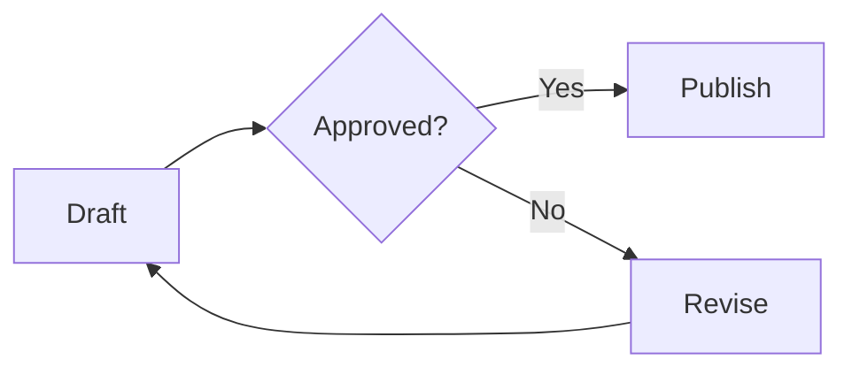
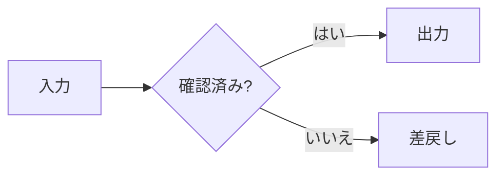
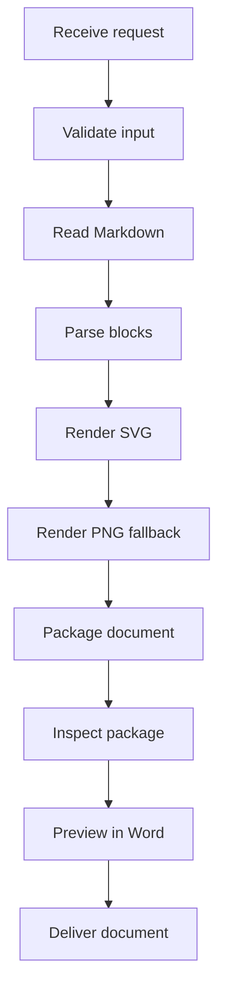

此綜合範例不包含任何專案或客戶資料。

## 核准流程

文件擁有者提交草稿。審查者可以核准或要求修改。

## 日文標籤

## 高長圖表

此圖表用於演練縮放與明確的分頁規則。

## 一般內容

| 項目 | 預期結果 |
| ---- | --------------- |
| SVG  | 保留 SVG |
| PNG  | 保留 PNG |
| 文字 | 兩種語言 |

- 保留 Markdown 原始碼。
- 在 Word 中檢查文件。

> 向量輸出並非可編輯的 Office 流程圖。
